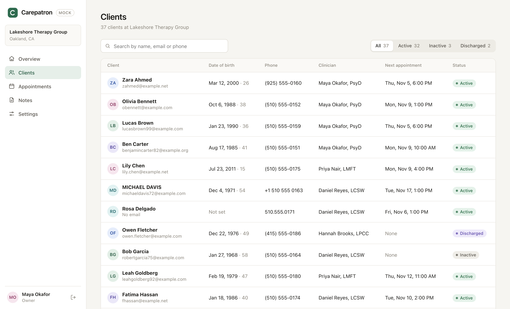

<div align="center">

# Set up your practice in one click

</div>

Every week, practitioners move to Carepatron from our competitors: the practice management and EHR platforms that most therapists and health practitioners use today. Years of their work live in those systems: clients, notes, appointments, insurance details, and how the practice is set up. Moving all of it by hand is slow and stressful.

**Build the tool that moves it for them.** A practitioner enters the login details for their old platform, and AI moves their whole practice into Carepatron.

It should be excellent with our biggest competitors, and work with any platform a practitioner might be leaving. Working out which those are is part of the job, and how you get there is up to you.

## Where practices come from

Our competitors' platforms. Sign up for trials of the ones you build for, and set up a practice in each: clients, appointments, notes, insurance and settings. Most of them offer a free trial.

> [!WARNING]
> Use made-up people and details only. Never put real client information into a trial account, or through your tool.

## Where they go

This repo has a mock of Carepatron, with a web app and a JSON API. It starts empty, like a practitioner's account on their first day. Your tool moves the practice into it, and everything it moves is kept in a SQLite database, so you can show exactly what came across and that it's right.



You'll need Node.js 24 or later:

```bash
cd carepatron
npm install
npm start
```

Then open [localhost:4000](http://localhost:4000) and sign in as the practice owner:

| Email | Password |
| --- | --- |
| `you@practice.example` | `carepatron` |

`npm run demo` opens a practice that's already set up, at [localhost:4001](http://localhost:4001), so you can see one with real work in it. The mock's [README](carepatron/README.md) covers its API and database.

## What to send us

1. **Your code** in a new private GitHub repository: clone this one, push it there, and invite [@davidpene](https://github.com/davidpene). Please don't fork it, because forks of a public repo are public too.
2. **A README** covering how to run it (including any API keys it needs), how it works, and the choices you made.
3. **A short video** (Loom or similar) of your tool moving a practice from a real platform into the mock, end to end.
4. **A few notes:** what you'd do with more time, how long it took, and how you found it.

Then reply to the email this came with, with links to your repo and video.

## Good to know

- Use any language, framework, model or provider. AI coding tools are welcome; we use them every day.
- If something isn't clear, make a sensible call and tell us what you assumed.

<br>

<p align="center"><sub>Everyone in the mock is made up. Any resemblance to real people is a coincidence.</sub></p>
